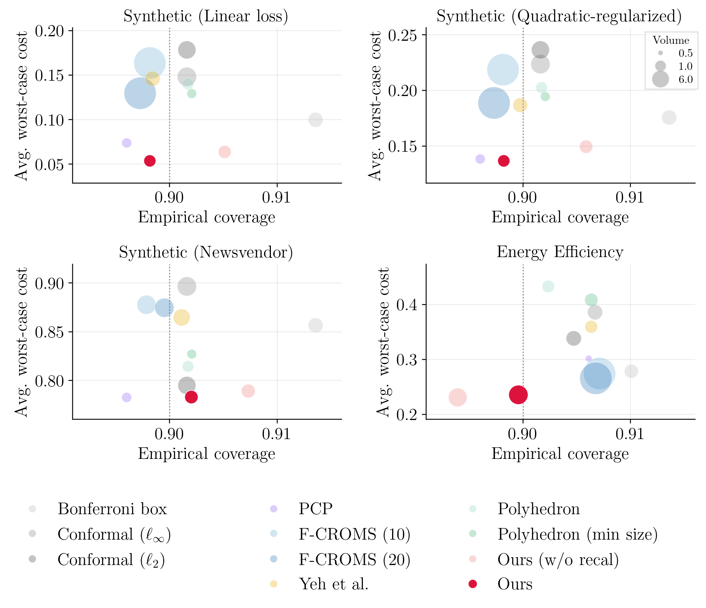

# Learning Polyhedral Conformal Sets for Robust Optimization

This repository contains the code for the paper

> **Learning Polyhedral Conformal Sets for Robust Optimization**  
> Shuyi Chen\*, Wenbin Zhou\*, and Shixiang Zhu (\*equal contribution)  
> *Advances in Neural Information Processing Systems (NeurIPS), 2026*  
> [arXiv:2605.08506](https://arxiv.org/abs/2605.08506)

Robust optimization makes decisions that hedge against every outcome in an uncertainty set. Conformal prediction gives such sets with a finite-sample coverage guarantee, but standard conformal sets ignore the downstream decision problem and can lead to overly conservative decisions. We learn polyhedral conformal sets whose cutting hyperplanes are chosen to minimize the induced robust loss, and recalibrate their size on an independent split so that the coverage guarantee still holds.

<p align="center">
  
</p>

Figure 3 of the paper. Empirical coverage (horizontal axis) and average worst-case cost (vertical axis) of each method on three synthetic tasks and the UCI Energy Efficiency data; bubble size is the volume of the uncertainty set, and the target coverage is 0.90.

## Installation

The code was tested with Python 3.10.

```bash
pip install -r requirements.txt
```

Our method requires [Gurobi](https://www.gurobi.com) and a license (free for academic use). For two-dimensional outcomes, four hyperplanes, and a linear or quadratic-regularized objective, it first solves an exact mixed-integer formulation with Gurobi and uses that solution if Gurobi certifies optimality within the time limit; otherwise, and in all other settings, it uses the pinball-loss gradient method, as described in the paper.

## Reproducing the results

Run the following from the repository root. Results are written to `results/`.

| Command | Paper |
| --- | --- |
| `make run-main` | Figure 3 and Tables 2–3 (all methods and tasks) |
| `make run-sweeps` | Figure 4 (sensitivity to the dimension, the number of hyperplanes, and the data split) |
| `make table1` | Table 1 (exact formulation versus pinball-loss approximation) |
| `make plots` | figures and LaTeX tables from the saved results |

`make paper` runs all of them. Each mixed-integer solve has a 30-minute limit, so the full runs take a long time on one machine. For a quick check with fewer seeds and a shorter limit:

```bash
make run-main MAIN_SEEDS=2 ENERGY_SEEDS=2 MIQCP_TIME_LIMIT=60
```

Runs can be resumed: seeds already saved in `results/main_by_seed.csv` are skipped. To run selected tasks or methods, call the runner directly, for example

```bash
python -m experiments.run_synthetic2d --experiments synthetic-linear --seed 2026 --n-seeds 1 \
    --methods "Conformal box,Ours (MIQCP/pinball)" --no-plots
```

## Repository layout

```
experiments/
├── run_synthetic2d.py       experiment runner: tasks, data splits, metrics
├── baselines.py             our method and all baselines
├── robust.py                robust decisions over the uncertainty sets
├── sets.py                  set representations, conformal quantiles, volumes
├── predictors.py            point predictor
├── synthetic_xy.py          synthetic data
├── real_data.py             UCI Energy Efficiency data (downloaded on first use)
├── run_exact_vs_pinball.py  exact formulation versus pinball-loss approximation
├── plot_paper.py            figures and tables
└── plots.py                 plotting helpers
```

## Citation

If you find this work useful, please cite

```bibtex
@inproceedings{chen2026learning,
  title     = {Learning Polyhedral Conformal Sets for Robust Optimization},
  author    = {Chen, Shuyi and Zhou, Wenbin and Zhu, Shixiang},
  booktitle = {Advances in Neural Information Processing Systems},
  year      = {2026}
}
```
